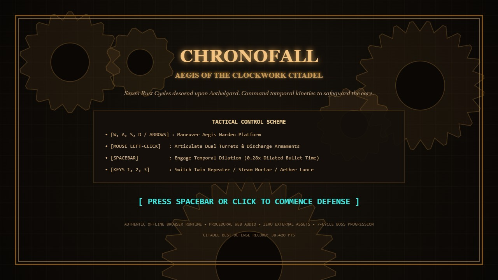

# CHRONOFALL: Aegis of the Clockwork Citadel

  

> An authentic offline temporal kinetic defense & clockwork survival game built for the [make.fun best-game-01](https://make.fun/bounty/best-game-01) competition.

---

## ⚙️ Narrative & Premise

In the towering clockwork fortress of **Aethelgard**, the ancient Chrono-Core maintains the flow of time against the entropy of the Rust Wastes. Seven brutal Rust Cycles have begun as legions of automated scrap-drones, pneumatic spitters, ironclad siege engines, and the colossal Oxidized Titan march upon the Citadel.

As the Warden of the Aegis Platform, harness temporal dilation to manipulate time, calibrate twin brass repeaters, discharge pneumatic steam mortars, and fire crystal resonance lances to safeguard humanity's last temporal sanctuary.

---

## 🎮 Gameplay Features

* **Authentic 100% Offline Static Web Runtime**: Zero external network dependencies, libraries, or asset downloads. Runs instantly from static files in any modern desktop browser.
* **Temporal Dilation Engine**: Engage real-time bullet-time (*0.28x chronal speed*) using the spacebar to weave through dense projectile barrages and execute pinpoint defensive strikes.
* **The Clocksmith Forge**: Spend salvaged Aether Shards between combat cycles across 3 distinct tech trees: *Kinetic Overclocking*, *Aether Resonance*, and *Chronal Gyro Stabilizers*.
* **Procedural Web Audio API Synthesizer**: Zero audio files. All mechanical clockwork ticks, pneumatic steam releases, laser hums, and brass victory fanfares are procedurally synthesized in real time.
* **7-Cycle Boss Progression**: Face increasingly intelligent automaton cohorts culminating in a multi-phase showdown against *The Oxidized Colossus*.

---

## 🕹️ Controls

| Action | Keybinding |
| :--- | :--- |
| **Maneuver Platform** | `W, A, S, D` or `Arrow Keys` |
| **Aim & Discharge Armament** | `Mouse Pointer` + `Left Mouse Button` |
| **Temporal Dilation (Slow-Mo)** | `Spacebar` (Toggles on/off, consumes Aether Flux) |
| **Chrono Surge Overdrive** | `E` (Temporary infinite fire rate & invulnerability) |
| **Switch Weapon (Repeater)** | `1` (Rapid twin kinetic cannon) |
| **Switch Weapon (Steam Mortar)**| `2` (Pneumatic area-of-effect explosive) |
| **Switch Weapon (Aether Lance)** | `3` (Piercing crystal energy beam) |
| **Select & Forge Upgrades** | `W/S` to navigate, `Enter` to forge, `Space` to begin cycle |

---

## 🏗️ Technical Architecture

* **Entrypoint**: `main.ts` (Node 22 ESM runtime)
* **Viewport Resolution**: 1280 × 720 fixed aspect ratio canvas with vector-crisp rendering
* **Engine Modules**:
  * `game/src/config.js`: Balancing matrices, 7-wave enemy schemas, and weapon parameters.
  * `game/src/audio.js`: Zero-asset procedural Web Audio synthesizer.
  * `game/src/input.js`: Normalized coordinate mapping and non-blocking input listener.
  * `game/src/particles.js`: Object-pooled particle simulator (steam, sparks, flying gears, ripples).
  * `game/src/systems/time.js`: Fixed-step temporal dilation and aether flux regulator.
  * `game/src/systems/forge.js`: Inter-wave talent matrix and upgrade persistence.
  * `game/src/entities/`: Modular player Warden platform and 7 enemy automaton archetypes.
  * `game/src/render.js`: Steampunk brass vector renderer with dynamic lighting and 4 UI stages.
  * `game/src/shots.js`: Deterministic staging engine generating reproducible 1280x720 screenshots.

---

## 📜 License

[MIT](LICENSE) © 2026 Syukur. Authored with Google Antigravity AI for make.fun.
SPDX-License-Identifier: MIT
